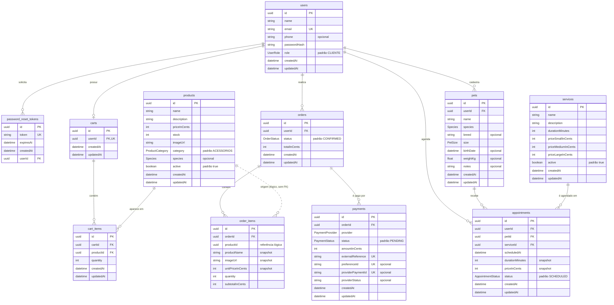

# Banco de dados

Modelo de dados do PetShop Online (item 1.5 do roteiro da Sprint 1).

| Arquivo | Conteúdo |
| --- | --- |
| `README.md` | Este arquivo: DER, entidades, relacionamentos e regras de integridade |
| `script.sql` | Script SQL completo do banco (PostgreSQL 16) |
| `der.mmd` | Código-fonte do DER em Mermaid, usado para gerar a imagem |

A fonte oficial do modelo é `backend/prisma/schema.prisma`. O script e o DER foram gerados a partir dele.

**Imagem do DER para o documento:** abra https://mermaid.live, apague o exemplo, cole o conteúdo de `der.mmd` e use **Actions → PNG** (ou SVG, que não perde qualidade ao ampliar).

## Diagrama entidade-relacionamento

O GitHub desenha o diagrama abaixo automaticamente.



**Como ler:** `PK` é a chave primária, `FK` é a chave estrangeira e `UK` é um valor único. A linha contínua é um relacionamento com chave estrangeira. A linha tracejada é um vínculo lógico, sem chave estrangeira. Nas pontas, a barra significa "um", o círculo significa "zero" (opcional) e o pé de galinha significa "muitos".

## Tipos enumerados

| Enum | Valores | Usado em |
| --- | --- | --- |
| `UserRole` | `CLIENTE`, `ADMIN` | `users.role` |
| `OrderStatus` | `PENDING_PAYMENT`, `CONFIRMED`, `PROCESSING`, `COMPLETED`, `CANCELLED` | `orders.status` |
| `PaymentProvider` | `MERCADO_PAGO` | `payments.provider` |
| `PaymentStatus` | `PENDING`, `APPROVED`, `REJECTED`, `CANCELLED`, `REFUNDED` | `payments.status` |
| `ProductCategory` | `RACAO`, `PETISCOS`, `HIGIENE`, `BRINQUEDOS`, `ACESSORIOS`, `FARMACIA` | `products.category` |
| `Species` | `CAO`, `GATO`, `OUTRO` | `products.species`, `pets.species` |
| `PetSize` | `P`, `M`, `G` | `pets.size` |
| `AppointmentStatus` | `SCHEDULED`, `CONFIRMED`, `COMPLETED`, `CANCELLED` | `appointments.status` |

## Entidades

| Tabela | Finalidade | Principais atributos |
| --- | --- | --- |
| `users` | Usuário com perfil CLIENTE ou ADMIN. | Nome, e-mail único, telefone opcional, hash da senha, perfil. |
| `password_reset_tokens` | Token temporário de recuperação de senha. | Token único, validade, usuário. |
| `products` | Produto do catálogo. | Nome, descrição, preço em centavos, estoque, imagem, categoria, espécie, situação (ativo). |
| `carts` | Carrinho único do usuário. | Usuário (único). |
| `cart_items` | Item do carrinho. | Carrinho, produto, quantidade. Um produto aparece uma vez por carrinho. |
| `orders` | Pedido do usuário. | Usuário, status, total em centavos. |
| `order_items` | Cópia (snapshot) do produto no momento da compra. | Nome, imagem e preço da época, quantidade, subtotal. |
| `payments` | Tentativa de pagamento de um pedido no Mercado Pago. | Pedido, provedor, status, valor, referência externa, IDs do Mercado Pago. |
| `pets` | Animal do cliente. | Dono, nome, espécie, raça, porte, nascimento, peso, observações. |
| `services` | Serviço oferecido pela loja (banho, tosa etc.). | Nome, descrição, duração, preço por porte (P, M, G), situação (ativo). |
| `appointments` | Agendamento de um serviço para um pet. | Cliente, pet, serviço, data e hora, duração e preço da época, status. |

## Relacionamentos

| Relacionamento | Cardinalidade | Ao excluir o "lado um" |
| --- | --- | --- |
| users – password_reset_tokens | 1:N | Os tokens são excluídos (cascade). |
| users – carts | 1:0..1 | O carrinho é excluído (cascade). |
| users – orders | 1:N | Bloqueado enquanto houver pedidos (restrict). |
| users – pets | 1:N | Os pets são excluídos (cascade). |
| users – appointments | 1:N | Os agendamentos são excluídos (cascade). |
| carts – cart_items | 1:N | Os itens são excluídos (cascade). |
| products – cart_items | 1:N | Bloqueado enquanto o produto estiver em algum carrinho (restrict). |
| orders – order_items | 1:N | Os itens são excluídos (cascade). |
| orders – payments | 1:N | Os pagamentos são excluídos (cascade). |
| products – order_items | 1:N (lógico) | Sem chave estrangeira. O item guarda nome, imagem e preço, então o histórico continua válido se o produto mudar ou for excluído. |
| pets – appointments | 1:N | Os agendamentos são excluídos (cascade). |
| services – appointments | 1:N | Bloqueado enquanto houver agendamentos (restrict). |

## Regras de integridade

1. E-mail do usuário é único.
2. Cada usuário tem no máximo um carrinho.
3. Um produto aparece uma vez por carrinho (`UNIQUE (cartId, productId)`). Adicionar de novo só aumenta a quantidade.
4. Preços e totais são guardados em centavos (inteiros) e calculados no backend.
5. Produto inativo some do catálogo, mas continua no histórico dos pedidos.
6. Itens de pedido guardam nome, imagem e preço da época da compra.
7. Agendamentos guardam a duração e o preço da época do agendamento, calculados pelo porte do pet.
8. Um pedido pode ter várias tentativas de pagamento. A referência externa (`externalReference`) e os IDs do Mercado Pago são únicos.
9. Toda mudança na estrutura do banco é feita por migration (`backend/prisma/migrations/`).

## O que mudou desde a primeira entrega

O DER da primeira entrega (Figura 8 do documento) cobria só o núcleo do e-commerce, com 7 tabelas. O modelo atual tem 11:

- **Novas tabelas:** `payments` (Mercado Pago), `pets`, `services` e `appointments`.
- **Novas colunas:** `users.phone`, `products.category` e `products.species`.
- **Novo status de pedido:** `PENDING_PAYMENT`, usado enquanto o pagamento não é confirmado.
- **Novos enums:** `ProductCategory`, `Species`, `PetSize`, `AppointmentStatus`, `PaymentProvider` e `PaymentStatus`.

## Como gerar o script SQL de novo

Sempre que o `schema.prisma` mudar:

```bash
cd backend
npx prisma migrate diff --from-empty --to-schema-datamodel prisma/schema.prisma --script > ../docs/banco/script.sql
```

O script cria o banco do zero, num banco vazio. Ele **não** substitui as migrations: para o app, continue usando `npx prisma migrate deploy`.
